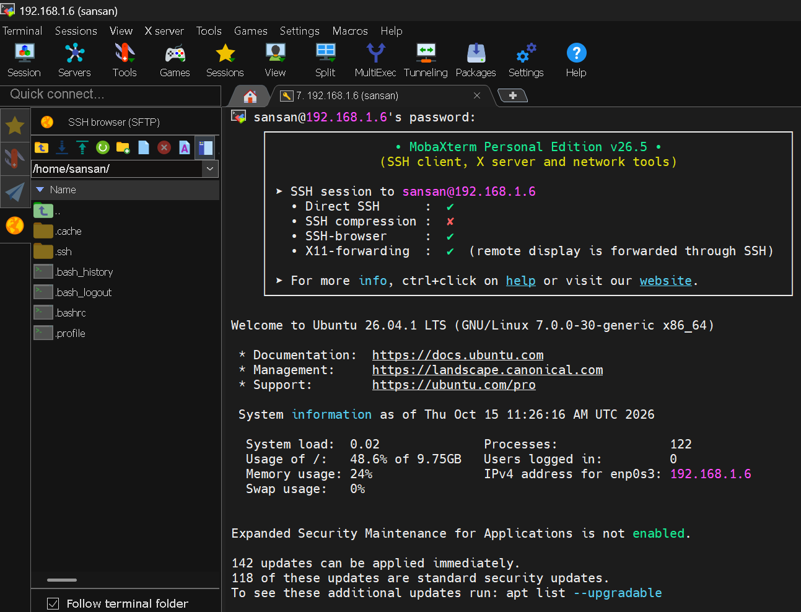
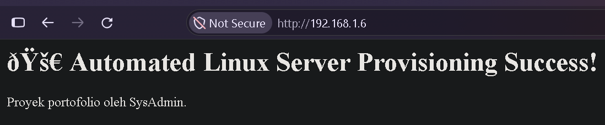

# 🚀 Automated Linux Server Provisioning & Hardening

Proyek ini berisi skrip otomasi untuk melakukan pembaruan, konfigurasi keamanan (*hardening*), dan penyiapan layanan dasar pada Linux Server dari kondisi bersih hingga siap digunakan untuk lingkungan produksi.

---

## 💻 Tech Stack & Tools yang Digunakan

| Kategori | Tools / Software | Keterangan & Tautan Unduhan |
| :--- | :--- | :--- |
| **Host OS** | Windows 11 | Sistem operasi utama pada komputer fisik. |
| **Virtualization** | [Oracle VM VirtualBox](https://www.virtualbox.org/) | Digunakan untuk menjalankan mesin virtual Ubuntu Server. |
| **Network Mode** | Bridged Adapter | Menghubungkan VM langsung ke jaringan lokal/internet. |
| **Guest OS** | [Ubuntu Server LTS](https://ubuntu.com/download/server) | Sistem operasi server yang di-provisioning. |
| **Remote Access** | [MobaXterm](https://mobaxterm.mobatek.net/) | Klien SSH dan terminal untuk meremote server dari Windows. |
| **Automation** | Bash Scripting | Bahasa skrip untuk otomatisasi instalasi dan konfigurasi. |
| **Security** | UFW (Uncomplicated Firewall) | Mengatur aturan lalu lintas jaringan (*firewall hardening*). |
| **Web Server** | Nginx | Web server untuk menyajikan halaman uji coba. |
| **Version Control** | [Git](https://git-scm.com/) & [GitHub](https://github.com/) | Penyimpanan kode sumber dan portofolio proyek. |

---

## 🛠️ Fitur Otomasi Skrip (`setup-server.sh`)

- [x] **System Update & Upgrade:** Memperbarui seluruh paket sistem secara otomatis.
- [x] **Package Installation:** Menginstal tools penting (`curl`, `git`, `htop`) dan *Web Server* Nginx.
- [x] **Firewall Hardening (UFW):** Mengatur aturan lalulintas jaringan secara ketat (menutup port masuk secara default dan hanya membuka port penting seperti SSH dan HTTP).
- [x] **Custom Landing Page:** Otomatis membuat halaman sambutan uji coba web server.

---

## 📸 Hasil Pengujian
### 1. MobaXterm


### 2. Eksekusi Skrip Otomasi di Terminal


### 3. Verifikasi Web Server dari Browser Windows


---

## 🚀 Cara Menjalankan Skrip

1. Clone repositori ini ke server target:
   ```bash
   git clone [https://github.com/sansan1919/linux-server-provisioning.git](https://github.com/sansan1919/linux-server-provisioning.git)
   cd linux-server-provisioning/scripts
